# Práctica 1.4 · HTTPS con un certificado SSL/TLS autofirmado en Apache

**Despliegue de Aplicaciones Web · 2º DAW · Curso 2026/2027**
**Alumno:** Francisco López Lobanova · GitHub: [Frxnker](https://github.com/Frxnker)

En esta práctica se crea un certificado SSL/TLS **autofirmado** con `openssl` y se configura el servidor web Apache para que sirva el sitio por **HTTPS**, redirigiendo automáticamente todo el tráfico HTTP a HTTPS. Todo el proceso está automatizado con scripts de Bash sobre una instancia EC2 de AWS con Ubuntu Server.

---

## Índice

- [Práctica 1.4 · HTTPS con un certificado SSL/TLS autofirmado en Apache](#práctica-14--https-con-un-certificado-ssltls-autofirmado-en-apache)
  - [Índice](#índice)
  - [1. Certificado autofirmado vs. certificado de una CA](#1-certificado-autofirmado-vs-certificado-de-una-ca)
  - [2. Creación de la instancia](#2-creación-de-la-instancia)
    - [Grupo de seguridad](#grupo-de-seguridad)
    - [Conexión por SSH](#conexión-por-ssh)
  - [3. Estructura del repositorio](#3-estructura-del-repositorio)
  - [4. Variables de configuración (.env)](#4-variables-de-configuración-env)
  - [5. Instalación de la pila LAMP](#5-instalación-de-la-pila-lamp)
  - [6. Creación del certificado autofirmado](#6-creación-del-certificado-autofirmado)
  - [7. Configuración de Apache para HTTPS](#7-configuración-de-apache-para-https)
    - [7.1. VirtualHost HTTPS (puerto 443)](#71-virtualhost-https-puerto-443)
    - [7.2. Habilitar el sitio y el módulo SSL](#72-habilitar-el-sitio-y-el-módulo-ssl)
    - [7.3. Redirección de HTTP a HTTPS (puerto 80)](#73-redirección-de-http-a-https-puerto-80)
  - [8. Comprobación](#8-comprobación)
    - [8.1. Datos del certificado](#81-datos-del-certificado)
    - [8.2. Redirección HTTP → HTTPS](#82-redirección-http--https)
    - [8.3. Acceso desde el navegador](#83-acceso-desde-el-navegador)
  - [9. Cómo reproducir el despliegue](#9-cómo-reproducir-el-despliegue)
  - [Referencias](#referencias)

---

## 1. Certificado autofirmado vs. certificado de una CA

| Certificado autofirmado | Certificado emitido por una CA |
|---|---|
| Lo genera y firma el propio servidor | Lo firma una Autoridad de Certificación reconocida |
| Pasos: crear clave privada + certificado, y configurarlos en el servidor | Pasos: crear clave privada, generar una solicitud (CSR), enviarla a la CA, que la valida y emite el certificado, e instalarlo |
| El navegador muestra un aviso de que no es de confianza | El navegador lo acepta sin avisos |
| Útil para pruebas y entornos de aprendizaje | Necesario en sitios web públicos |

En ambos casos la conexión va **cifrada**. La diferencia es que con un certificado autofirmado el navegador no puede verificar la identidad del servidor.

---

## 2. Creación de la instancia

| Parámetro | Valor |
|---|---|
| Nombre | `Practica01-04` |
| Región | `us-east-1` (Norte de Virginia) |
| AMI | Ubuntu Server 26.04 LTS |
| Tipo de instancia | `t3.small` |
| Par de claves | `vockey` |
| Grupo de seguridad | `launch-wizard-8` |
| IP elástica | `3.88.238.239` |

Se ha asociado una IP elástica a la instancia para que su dirección pública no cambie al detenerla y arrancarla.

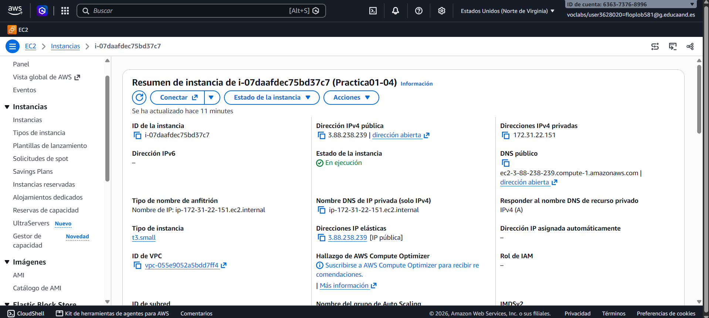

### Grupo de seguridad

| Puerto | Protocolo | Uso |
|---|---|---|
| 22 | TCP | SSH |
| 80 | TCP | HTTP (se redirige a HTTPS) |
| 443 | TCP | HTTPS |

El puerto **443** es imprescindible en esta práctica, ya que es el que utiliza HTTPS.

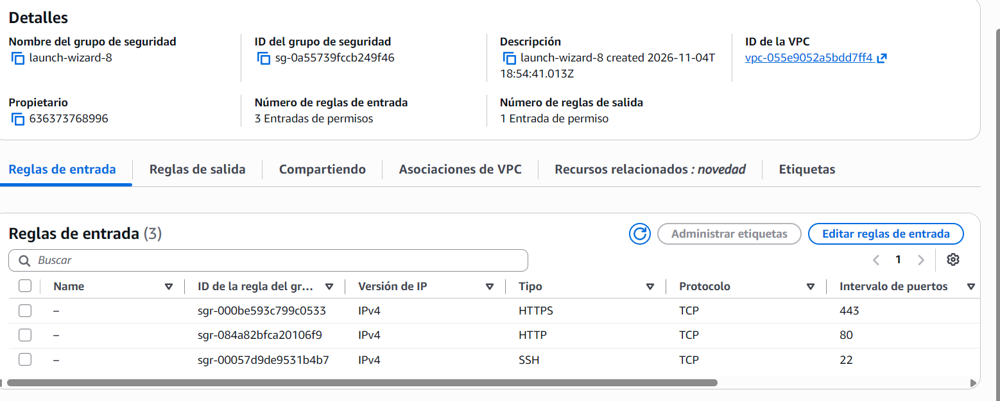

### Conexión por SSH

```powershell
ssh -i vockey.pem ubuntu@3.88.238.239
```

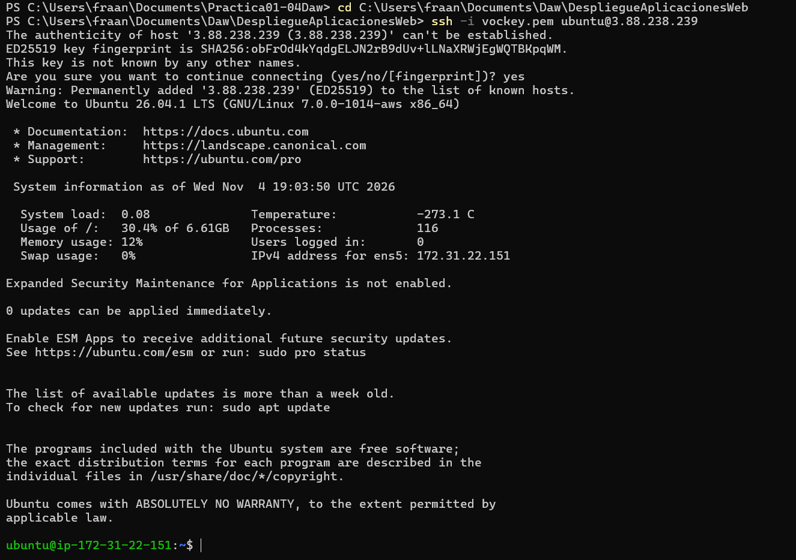

---

## 3. Estructura del repositorio

```
.
├── README.md
├── .gitignore
├── conf
│   ├── 000-default.conf
│   └── default-ssl.conf
├── img
└── scripts
    ├── .env.example
    ├── install_lamp.sh
    └── setup_selfsigned_certificate.sh
```

| Archivo | Función |
|---|---|
| `conf/000-default.conf` | VirtualHost del puerto 80. Redirige todo el tráfico a HTTPS |
| `conf/default-ssl.conf` | VirtualHost del puerto 443 con SSL/TLS activado |
| `scripts/install_lamp.sh` | Instala Apache, PHP y MySQL (reutilizado de prácticas anteriores) |
| `scripts/setup_selfsigned_certificate.sh` | Crea el certificado autofirmado y configura Apache para HTTPS |
| `scripts/.env.example` | Plantilla de las variables de configuración |

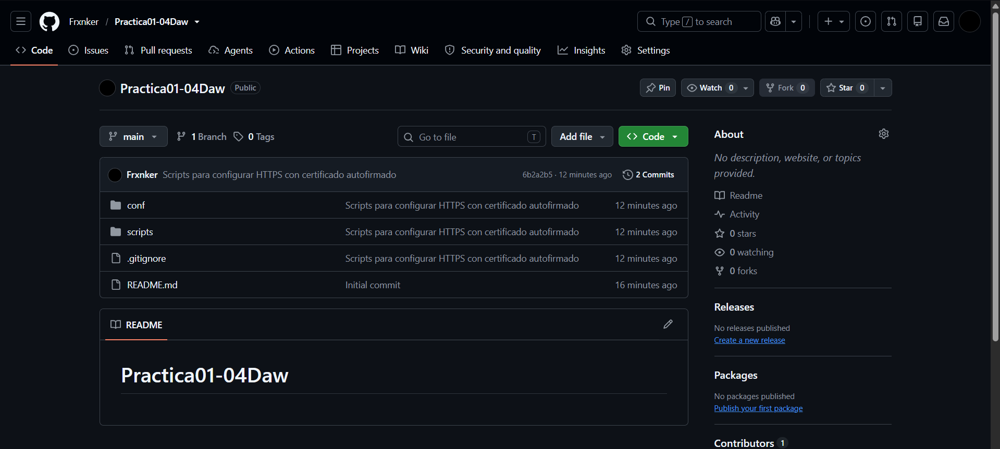

---

## 4. Variables de configuración (.env)

Los datos que se incluyen en el certificado se guardan en `scripts/.env`. Este archivo no se sube al repositorio (está en `.gitignore`); en su lugar se incluye `.env.example`.

Valores utilizados:

```
OPENSSL_COUNTRY="ES"
OPENSSL_PROVINCE="Almeria"
OPENSSL_LOCALITY="Almeria"
OPENSSL_ORGANIZATION="IES Celia Vinas"
OPENSSL_ORGUNIT="Departamento de Informatica"
OPENSSL_COMMON_NAME="practica-https.local"
OPENSSL_EMAIL="admin@iescelia.org"
```

| Variable | Campo del certificado |
|---|---|
| `OPENSSL_COUNTRY` | País (código de 2 letras) |
| `OPENSSL_PROVINCE` | Provincia |
| `OPENSSL_LOCALITY` | Localidad |
| `OPENSSL_ORGANIZATION` | Organización |
| `OPENSSL_ORGUNIT` | Unidad o departamento |
| `OPENSSL_COMMON_NAME` | Nombre de dominio (Common Name) |
| `OPENSSL_EMAIL` | Email de contacto |

Las comillas son necesarias porque algunos valores contienen espacios. Se ha evitado usar caracteres como la `ñ` para no tener problemas de codificación en el certificado.

---

## 5. Instalación de la pila LAMP

Se clona el repositorio en la instancia, se crea el `.env` y se ejecuta `install_lamp.sh`, el mismo script de las prácticas anteriores:

```bash
git clone https://github.com/Frxnker/Practica01-04Daw.git
cd Practica01-04Daw/scripts
cp .env.example .env
nano .env
chmod +x *.sh
sudo ./install_lamp.sh
```

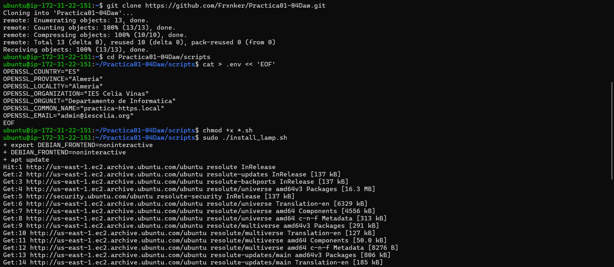

El script actualiza el sistema e instala Apache (con el módulo `rewrite` habilitado), PHP y MySQL Server.

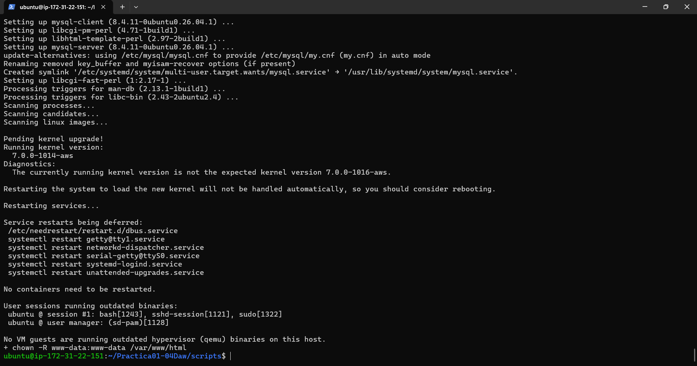

---

## 6. Creación del certificado autofirmado

Script: `scripts/setup_selfsigned_certificate.sh`

```bash
sudo ./setup_selfsigned_certificate.sh
```

El certificado se crea con `openssl`. Para que el proceso sea automático, los datos del certificado se pasan con el parámetro `-subj` en lugar de introducirlos por teclado:

```bash
openssl req \
  -x509 \
  -nodes \
  -days 365 \
  -newkey rsa:2048 \
  -keyout /etc/ssl/private/apache-selfsigned.key \
  -out /etc/ssl/certs/apache-selfsigned.crt \
  -subj "/C=$OPENSSL_COUNTRY/ST=$OPENSSL_PROVINCE/L=$OPENSSL_LOCALITY/O=$OPENSSL_ORGANIZATION/OU=$OPENSSL_ORGUNIT/CN=$OPENSSL_COMMON_NAME/emailAddress=$OPENSSL_EMAIL"
```

| Parámetro | Significado |
|---|---|
| `req` | Subcomando para crear solicitudes de certificado; con `-x509` crea directamente un certificado |
| `-x509` | Genera un certificado autofirmado en lugar de una solicitud para una CA |
| `-nodes` | La clave privada no se cifra con contraseña, así Apache puede usarla sin pedirla al arrancar |
| `-days 365` | El certificado es válido durante un año |
| `-newkey rsa:2048` | Genera una nueva clave privada RSA de 2048 bits |
| `-keyout` | Ruta donde se guarda la clave privada |
| `-out` | Ruta donde se guarda el certificado |
| `-subj` | Datos del certificado (país, provincia, organización, dominio…) |

Archivos generados:

- **Clave privada:** `/etc/ssl/private/apache-selfsigned.key`
- **Certificado:** `/etc/ssl/certs/apache-selfsigned.crt`

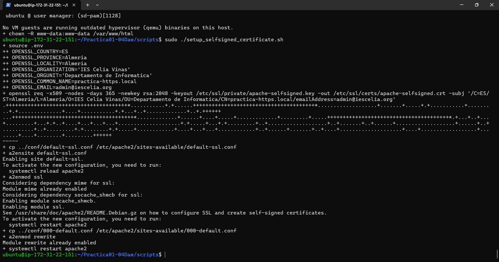

---

## 7. Configuración de Apache para HTTPS

El mismo script configura Apache en tres pasos.

### 7.1. VirtualHost HTTPS (puerto 443)

Se copia `conf/default-ssl.conf` a `/etc/apache2/sites-available/`:

```apache
<VirtualHost *:443>
    #ServerName practica-https.local
    DocumentRoot /var/www/html
    DirectoryIndex index.php index.html

    SSLEngine on
    SSLCertificateFile /etc/ssl/certs/apache-selfsigned.crt
    SSLCertificateKeyFile /etc/ssl/private/apache-selfsigned.key
</VirtualHost>
```

| Directiva | Función |
|---|---|
| `<VirtualHost *:443>` | El sitio escucha en el puerto 443 (HTTPS) |
| `DocumentRoot` | Directorio raíz del sitio |
| `SSLEngine on` | Activa SSL/TLS en este VirtualHost |
| `SSLCertificateFile` | Ruta del certificado |
| `SSLCertificateKeyFile` | Ruta de la clave privada |

### 7.2. Habilitar el sitio y el módulo SSL

```bash
a2ensite default-ssl.conf
a2enmod ssl
```

### 7.3. Redirección de HTTP a HTTPS (puerto 80)

Se copia `conf/000-default.conf`, que redirige cualquier petición HTTP a su equivalente en HTTPS:

```apache
<VirtualHost *:80>
    #ServerName practica-https.local
    DocumentRoot /var/www/html

    # Redirige al puerto 443 (HTTPS)
    RewriteEngine On
    RewriteCond %{HTTPS} off
    RewriteRule ^ https://%{HTTP_HOST}%{REQUEST_URI} [L,R=301]
</VirtualHost>
```

| Directiva | Función |
|---|---|
| `RewriteEngine On` | Activa el motor de reescritura de URLs |
| `RewriteCond %{HTTPS} off` | La regla solo se aplica si la petición no usa HTTPS |
| `RewriteRule ^ https://%{HTTP_HOST}%{REQUEST_URI}` | Redirige a la misma dirección y ruta, pero con `https://` |
| `[L,R=301]` | Redirección permanente (código 301) y última regla a procesar |

Para que funcione se necesita el módulo `rewrite`, que ya quedó habilitado con `install_lamp.sh`:

```bash
a2enmod rewrite
systemctl restart apache2
```

---

## 8. Comprobación

### 8.1. Datos del certificado

Información del sujeto y fechas de validez:

```bash
openssl x509 -in /etc/ssl/certs/apache-selfsigned.crt -noout -subject
openssl x509 -in /etc/ssl/certs/apache-selfsigned.crt -noout -dates
```

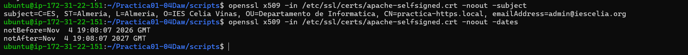

### 8.2. Redirección HTTP → HTTPS

```bash
curl -I http://localhost
```

El servidor responde con `301 Moved Permanently` y la cabecera `Location` apunta a la versión `https://`.

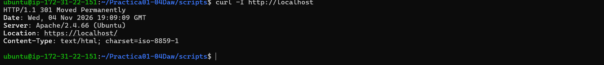

### 8.3. Acceso desde el navegador

Al acceder a `http://3.88.238.239`, Apache redirige automáticamente a `https://3.88.238.239`. Como el certificado es autofirmado, el navegador muestra un aviso de que la conexión no es privada. **Es el comportamiento esperado**: la conexión está cifrada, pero el certificado no ha sido emitido por una autoridad de certificación reconocida.

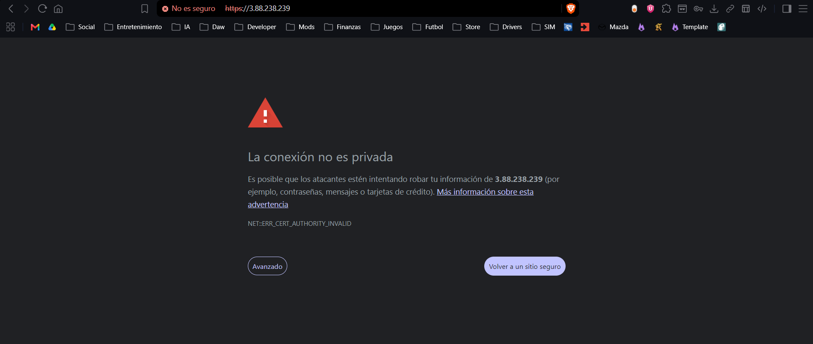

Tras aceptar el aviso, se muestra la página de Apache servida por HTTPS:

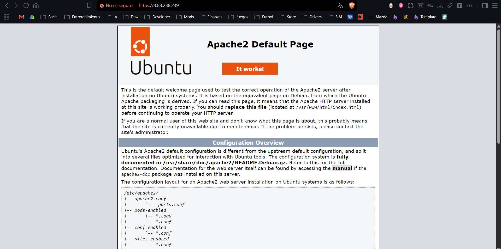

Desde el navegador también se pueden consultar los datos del certificado, que coinciden con los definidos en el `.env`:

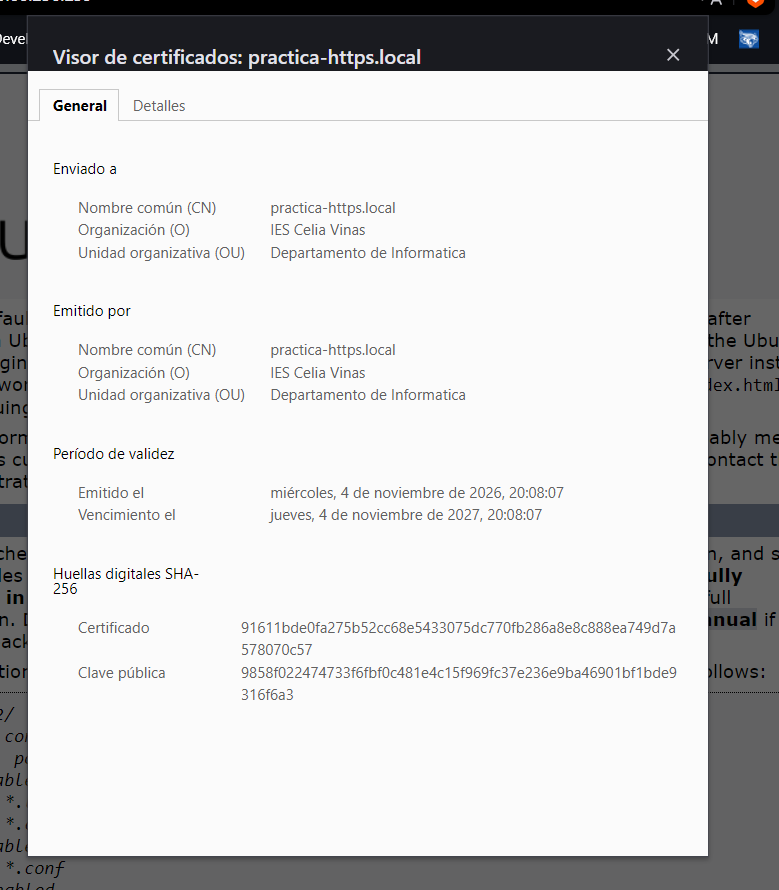

---

## 9. Cómo reproducir el despliegue

En una instancia Ubuntu Server con los puertos 22, 80 y 443 abiertos:

```bash
git clone https://github.com/Frxnker/Practica01-04Daw.git
cd Practica01-04Daw/scripts
cp .env.example .env
nano .env                 # rellenar los datos del certificado
chmod +x *.sh
sudo ./install_lamp.sh
sudo ./setup_selfsigned_certificate.sh
```

> Los scripts usan rutas relativas (`../conf`), así que deben ejecutarse desde dentro de la carpeta `scripts`.

---

## Referencias

- [Enunciado de la práctica](https://josejuansanchez.org/iaw/practica-01-04/index.html)
- [Módulo mod_rewrite de Apache](https://httpd.apache.org/docs/current/mod/mod_rewrite.html)
- [¿Qué es HTTPS? · Cloudflare](https://www.cloudflare.com/es-es/learning/ssl/what-is-https/)